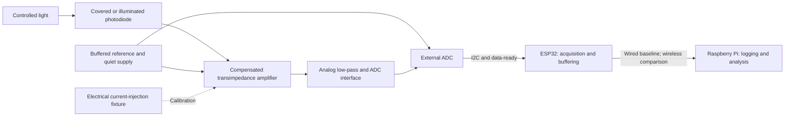

# Capstone: a photodiode scientific measurement instrument

[Course](COURSE.md) · [Laboratory](LAB.md) · [References](REFERENCES.md)

## Measurement and outcome

Design an instrument that converts photodiode current into a calibrated electrical reading, records it with known acquisition timing, and supports relative optical experiments. Build a custom KiCad PCB for the analog front end, converter, reference/power functions and interfaces. Development modules can provide the ESP32 and Raspberry Pi; neither chip-level RF layout nor a custom SBC is required.

Your final report should answer: what physical/electrical quantity is measured, over what range and bandwidth, with what noise and uncertainty, and which model predicts each limit?

The baseline reports **photocurrent in amperes and relative optical changes**. Reporting optical watts requires a wavelength-dependent responsivity calibration and optical geometry. Reporting lux additionally requires a defined photometric spectral response. Datasheet typical curves and an uncalibrated LED do not establish either absolute calibration.

## Reference architecture

Keep a wired acquisition baseline. Wireless is a comparison experiment and optional transport mode, so a radio-induced noise increase is observable rather than hidden in the only operating mode.

## Baseline design targets

These are **educational engineering targets**, not claims that a particular unbuilt circuit already meets them. Refine and freeze them at Module 17 using measured prototype evidence. Keep the initial and final specifications in the report; a change needs an engineering reason.

| Quantity | Initial target | Evidence |
| --- | --- | --- |
| Front-end supply and logic | Nominal 3.3 V; document actual rails and every device's valid common-mode/output ranges | Rail measurements, datasheet checks and power budget |
| Detector | Documented silicon photodiode; start with near-zero detector bias | Device identity, orientation, equivalent circuit and bias measurement |
| Transimpedance ranges | Approximately 100 kΩ and 1 MΩ; manual range selection is sufficient | Injected-current slope on each range |
| Nominal positive photocurrent ranges | 0–10 µA on 100 kΩ; 0–1 µA on 1 MΩ, conditional on headroom | Range sweep and saturation measurements |
| End-to-end small-signal bandwidth | Aim for −3 dB between 5 and 15 Hz on both ranges | Electrical and/or optical sweep with stimulus monitored |
| Acquisition | One continuously sampled differential channel, nominally 128 samples/s; measure actual rate | Data-ready timing, sequence counts and timestamp definition |
| Calibrated electrical linearity | Aim for residuals within 2% of reading over 10–90% of each stated current range, with reference uncertainty included | Calibration and independent validation points |
| Noise | Aim for ≤2 nA RMS input-referred on the high-gain range, integrated over 0.1–10 Hz with the detector covered | Raw dark record, documented PSD estimate, bandwidth integration and time-domain cross-check |
| Long recording | 30 minutes; no unexplained missing or duplicate samples | Sequence/timing audit, fault counters, saved raw records |
| Stability and recovery | No sustained oscillation on either range; quantify step settling, overshoot and recovery from safe optical overload | Analog scope traces, model/loop analysis, operating-point checks |
| Reproducibility | Regenerate every headline plot from saved raw data and identified calibration | Design release and analysis instructions |

Absolute accuracy cannot be inferred from residuals alone: a fit to an uncertain current source can be highly linear and still biased. If your reference or instrument cannot support the 2% target, improve it or report the supported uncertainty and unmet target explicitly. Passing the final review requires both an honest result and a concrete corrective design/measurement plan for any unmet frozen requirement.

## A feasible starting point

Use a buffered midrail reference, V_ref ≈ 1.65 V, with a single-supply low-input-bias op amp. Define positive injected current as entering the summing node. In the low-frequency linear regime,

`V_out − V_ref ≈ −I_in R_f`.

With this convention, 10 µA through 100 kΩ or 1 µA through 1 MΩ produces a nominal 1 V excursion below the reference, leaving V_out near 0.65 V. Check this against actual output swing, input common-mode range, overload behaviour, ADC pin limits and supply tolerance. Establish photodiode polarity from its datasheet and verify the observed sign; do not fix a wiring error by silently negating data.

The detector can operate with its terminals near the reference potential. The input model must include its capacitance, shunt/leakage behaviour, op-amp capacitance and board parasitics. Near-zero bias is useful for a slow detector but does not remove capacitance, leakage or ambient-temperature effects. The [BPW34 datasheet](https://www.vishay.com/docs/81521/bpw34.pdf) provides the relevant starting characteristics.

Put a feedback capacitor across each feedback resistor as required by the loop analysis. Compute the noise-gain shape and assess stability with the actual op-amp model. A downstream low-pass filter is useful for anti-aliasing but does not fix an unstable TIA. Treat the compensation equations in [TI's TIA application note](https://www.ti.com/lit/an/sboa055a/sboa055a.pdf) as model-based design guidance; validate the implementation and parasitic assumptions.

An **ADS1115-class external ADC** is a practical baseline for this slow channel. An illustrative setup uses a differential reading of signal minus reference and a ±2.048 V range. The ideal step for a signed 16-bit bipolar transfer is 4.096 V / 65,536 = **62.5 µV**, corresponding to **62.5 pA** through 1 MΩ before accounting for analog gain, converter noise and calibration. Effective precision must be measured. Configure a conversion-ready mechanism and read the actual [ADC datasheet](https://www.ti.com/lit/ds/symlink/ads1115.pdf); full-scale selection never permits input pins to exceed their supply-related limits.

Do not multiplex channels during the baseline timing/noise test. Additional channels require a new settling/timing argument. Place any filtering and input protection so that the ADC's dynamic input load is supported without destabilising the driver. The reference needs its own impedance, noise, decoupling and stability analysis.

## Analog and digital design review

Before layout, account for:

- Detector current range, room-light overload, bias, capacitance, temperature and shielding.
- Feedback-resistor tolerance/temperature coefficient, compensation, amplifier offset/bias/noise, and output headroom.
- Reference noise and drift, ADC error/noise/settling, alias rejection, and the transfer from current to raw code.
- Power sources, radio current pulses, return paths, decoupling, input contamination/leakage, connectors and test points.
- Data-ready behaviour, queue capacity, clock meaning, sample indices, range changes, and fault reporting.

Use a compact detector-to-amplifier connection. Keep high-impedance nodes away from fast digital traces and dirty surfaces. Avoid routing signals across gaps in their return path. Use a continuous return strategy appropriate to the design; splitting a plane merely because blocks are called “analog” and “digital” is not a justification.

Provide test points for supply, reference, TIA output, filtered output and a firmware timing marker. Do not attach a large probe directly to the summing node without assessing its perturbation. Use accessible packages/adapters and verified footprints. Manual feedback-range selection is acceptable; automatic switching introduces leakage and transient questions that are an optional extension.

## Calibration and characterisation procedure

### 1. Staged power-up

Inspect the unpowered board, measure resistance across its supply, and check polarity/orientation. Apply a conservative current limit. Verify supply current and rails; then the reference; then amplifier operating point; then the converter; then MCU communications. Add the Pi and radio workload after the analog baseline is understood. Save the observations, including failures and repairs.

### 2. Electrical current calibration

Inject current through a measured resistor from a known low-noise voltage into the summing node. For a source V_cal and summing potential near V_ref,

`I_in ≈ (V_cal − V_ref) / R_cal`.

Measure or bound source loading, the actual voltage difference, resistor uncertainty and temperature dependence. Include finite virtual-node error when it matters. A nominal resistor and an unmeasured nominal voltage are not a current standard. Isolate the optical input or cover the detector during this procedure; record the zero/background treatment.

Measure zero plus at least five points spanning each range, including points not used to fit gain and offset. Use more than two fit points to inspect nonlinearity, and reserve independent validation points or a separate sweep. Fit current versus raw ADC code for each range, save coefficients and their uncertainty, and inspect residuals. Repeat an increasing/decreasing sweep to look for drift, settling or hysteresis. Do not call a two-point fit an independent linearity test.

### 3. Frequency response and aliasing

Apply a small electrical current modulation or a monitored optical modulation and sweep through the useful band. Ensure the light source/stimulus does not set the measured cutoff. Fit the entire chain, including TIA compensation, analog filter, converter response and digital processing. Report the gain and phase conventions and actual sample rate.

At a nominal 128 samples/s, a 120 Hz interferer can fold to 8 Hz. Room lighting or PWM can therefore imitate a slow optical signal. Inject a known out-of-band modulation, compare its aliased response with and without the analog filter, and assess the result against an explicit interference/error budget. Digital filtering after aliasing cannot reconstruct the lost distinction.

### 4. Stability, overload and noise

On both ranges, observe a small step with an analog scope and compare it with the predicted response. Inspect faster behaviour at the TIA output as well as the slow final output: a slow ADC can hide an oscillating front end. Change a plausible detector/load capacitance within the design envelope and reassess stability. Document the limits of any inferred stability margin.

With the detector covered, record at least ten minutes at the chosen settings. Save raw codes, calibration identity, sample timing and status. Estimate the spectrum using a documented window/segment method and one-sided PSD normalisation; integrate 0.1–10 Hz and compare with the matching time-domain filtered variance. State detrending/filtering and distinguish slow drift from the specified band-limited noise. Show the measurement floor or a bound if the electronics cannot resolve the predicted detector noise.

Compare dark versus illuminated noise, radio on/off, and alternative power configurations. Control temperature and illumination well enough to distinguish the mechanism under test. Ambient changes are part of the experiment, not evidence of amplifier noise by default.

### 5. Acquisition and fault integrity

Record at least: session/boot ID, monotonic sample sequence, acquisition timing information, raw signed ADC code, gain range, status/fault counters and calibration ID. Store firmware/tool versions and the nominal/measured sample rate as session metadata. Keep raw data immutable; derive engineering units in a reproducible analysis step.

Define whether a timestamp denotes conversion-ready detection, register read, or another event, and bound interrupt/transport latency. The ADC clock sets conversion timing in the baseline architecture. Pi wall-clock time is useful metadata; packet-arrival spacing is not the sample clock.

Run for 30 minutes. Interrupt/restart the host and one transport path. Demonstrate either retained data within a measured buffer limit or an explicit gap and fault count; never invent timestamps or silently interpolate missing samples into the raw record. Verify a range change flushes/settles as needed and is recorded.

### 6. Relative optical experiment

Measure a controlled change in light while keeping geometry fixed. A suitable experiment is transmission through several materials, a slowly modulated source, or detector response versus distance where source geometry is explicitly modelled. Estimate dark offset and repeatability; avoid assuming inverse-square behaviour in the near field of an extended source. Report relative changes and photocurrent with their uncertainties.

## Release package

Keep these artefacts together and identify their versions:

1. Requirements and the final acceptance table, including failed targets.
2. Circuit derivations, model sources, simulation settings and design tradeoffs.
3. KiCad schematic/PCB, BOM, verified footprints, fabrication/assembly outputs and ERC/DRC review.
4. Firmware source/configuration and Raspberry Pi acquisition/analysis instructions.
5. Raw calibration/characterisation records, metadata and independent validation measurements.
6. Reproducible plots: gain/linearity, frequency response, noise PSD/integral, drift, overload recovery and sample integrity.
7. An uncertainty budget that separates random noise, calibration/reference uncertainty, systematic effects and environmental sensitivity.
8. A short redesign addressing one changed requirement and one observed limitation.

The project is complete when the evidence supports its claims, including the limits of the measurement. A polished enclosure and a live graph are useful finishing work after the circuit, timing and calibration are defensible.
